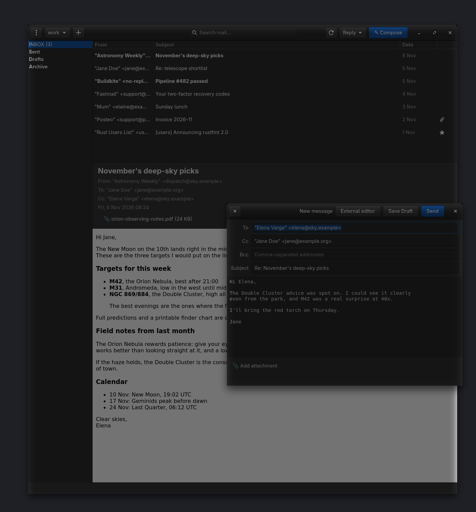

# btcx: a mail user agent for Linux

btcx composes, reads, searches, and watches mail, and does little else. No
calendar, no contacts, no feed reader. HTML mail opens in a hardened
WebKitGTK view with JavaScript disabled and no network requests of its own;
links open in your browser.



## Highlights

- First run with no configuration: btcx writes commented example config
  files and opens a setup wizard that finds your servers, tests the
  connection, and creates the account. Editing the files by hand works
  too, with the examples always at hand.
- A GTK4 interface: folder sidebar, fast message list, reader pane,
  compose window.
- Compose and read plain-text and HTML mail, with attachments and inline
  images.
- HTML mail opens with full layout and inline images. JavaScript and
  plugins are off, every image is served as an inlined data URI so the
  view never touches the network, remote images stay blocked until you
  allow them, and links open in your browser.
- Every remote message is sanitized before display, and tracking images
  are blocked by default.
- Built-in editor, or your own: nvim, vim, helix, anything `$VISUAL`
  points at.
- Watches for new mail over IMAP IDLE and updates the list live.
- Plain-text configuration in `~/.config/btcx/*.toml`.
- Sandboxed Lua scripting for automation hooks.
- One binary; the shared libraries are the GTK4 stack your desktop
  already ships.

## Requirements

- Linux with GTK4 and WebKitGTK 6 (the GTK4 flavour, packaged as
  `libwebkitgtk-6.0-dev` on Debian/Ubuntu and `webkitgtk6-devel` on
  Fedora). The older `webkit2gtk-4.1` will not work: it links GTK3.
- To build: Go 1.24+, a C toolchain, and the GTK4 development headers
  (`libgtk-4-dev` on Debian/Ubuntu, `gtk4-devel` on Fedora).

## Building

```sh
git clone <repo> btcx && cd btcx
go build -o btcx ./cmd/btcx
```

With version metadata:

```sh
go build -ldflags "-X btcx/internal/buildinfo.version=v0.1.0 \
  -X btcx/internal/buildinfo.commit=$(git rev-parse --short HEAD) \
  -X btcx/internal/buildinfo.date=$(date -u +%Y-%m-%dT%H:%M:%SZ)" \
  -o btcx ./cmd/btcx
```

## First run

Launch `btcx` with no configuration and it:

1. Creates `~/.config/btcx/` with a fully commented `config.toml`,
   `accounts/example.toml.example` (a complete account-setup walkthrough,
   including real Gmail, Outlook, Fastmail and Yahoo settings and both
   password options) and `scripts/example.lua.example`.
2. Opens a setup window for your address, incoming (IMAP) and outgoing
   (SMTP) servers, with a "Detect settings" guess based on your domain,
   and a password (stored in the file, or supplied by a command such as
   `pass`).
3. Verifies the IMAP login and SMTP submission with "Test connection"
   before anything is written; "Create account" writes
   `~/.config/btcx/accounts/<name>.toml` (mode 600) and connects.

Prefer editing files? Everything the wizard writes is plain commented
TOML. Open the config folder from the welcome screen, copy the example,
edit it, and press "Reload configuration".

## Configuration

Everything lives under `~/.config/btcx/` (or `$XDG_CONFIG_HOME/btcx`):

- `config.toml`: theme, external editor, watching, remote-content policy,
  scripting, logging.
- `accounts/<name>.toml`: IMAP/SMTP servers, credentials, folders,
  signature. Passwords come from the file (keep it `chmod 600`) or from a
  `password_command` such as `pass show mail/example.org`; btcx runs it
  without a shell.
- `remote_images.toml`: sender domains whose remote images load without
  asking. btcx writes it when you press "Always from ..." in the reader.

btcx generates the example files on first launch and never overwrites
them.

## Testing

```sh
gofmt -l .                    # must print nothing
golangci-lint run ./...       # standard linters + gosec (config: .golangci.yml)
go test ./...                 # unit + integration (in-process IMAP/SMTP servers)
go test -race ./...
go test ./internal/pipeline/...   # hostile-mail security pipeline
```

## Design

`AGENTS.md` documents the architecture, the development workflow, and the
security rules every change has to satisfy.

## License

Copyright (c) 2026 btcx contributors.

Licensed under the European Union Public Licence v1.2. See `LICENSE` for
the full text.
